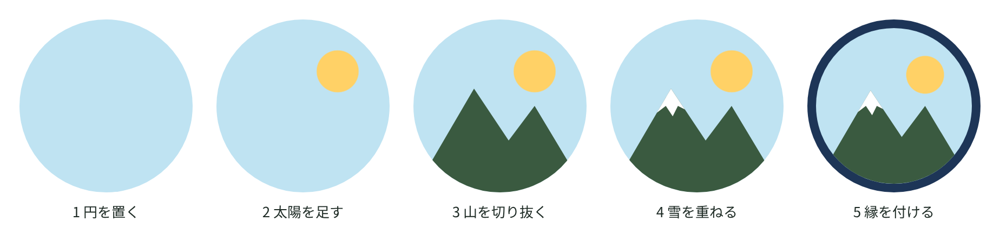

# 1章 まず1枚描く

## この章でできるようになること

- 要素1つで、山と太陽のバッジを描く
- 「背景で描く」「切り抜いて描く」「重ねて描く」の3つの基本動作を体験する

理屈は2章以降に回します。ここではコードを写して、5段階で絵が出来上がるのを見てください。所要時間は30分ほどです。



*図1-1 この章で描くバッジ。左から順に1段階ずつ足していく*

## 準備

HTMLファイルを1つ作り、次の内容を書きます。絵になる要素は `div` 1つだけです。

```html
<!DOCTYPE html>
<html lang="ja">
<head>
<meta charset="utf-8">
<style>
  .badge {
    /* ここに書いていく */
  }
</style>
</head>
<body>
  <div class="badge"></div>
</body>
</html>
```

## 手順1 円を置く

```css
.badge {
  width: 160px;
  aspect-ratio: 1;        /* 高さを幅と同じにする */
  border-radius: 50%;     /* 正方形を円にする */
  background: #bfe3f2;    /* 空の色 */
  position: relative;     /* あとで中に部品を重ねるため */
  overflow: hidden;       /* 円からはみ出た部分を隠す */
}
```

水色の円が出れば成功です。`aspect-ratio: 1` で正方形にしておくと、あとで `width` だけ変えれば全体が拡縮します。

## 手順2 太陽を足す（背景で描く）

要素を増やさず、背景のグラデーションで円を描きます。`background` を次のように書き換えてください。

```css
.badge {
  background:
    radial-gradient(circle at 70% 30%, #ffd166 0 12%, transparent 12.5%),
    #bfe3f2;
}
```

`radial-gradient` は本来、中心から外へ色が変わっていく模様です。ここでは「0〜12%まで黄色、12.5%から先は透明」と指定して、ぼかしのない円にしています。`circle at 70% 30%` が中心の位置です。カンマで区切ると背景を重ねられ、先に書いたものが手前になります。

## 手順3 山を切り抜く

山は三角形が2つ並んだ形です。疑似要素 `::before` を円と同じ大きさに広げ、山の形に切り抜きます。

```css
.badge::before {
  content: "";
  position: absolute;
  inset: 0;               /* 親と同じ大きさに広げる */
  background: #3a5a40;
  clip-path: polygon(0 100%, 35% 40%, 55% 70%, 70% 50%, 100% 100%);
}
```

`clip-path: polygon()` は、頂点を順に結んだ多角形の内側だけを残します。座標は「左から何%、上から何%」です。左下 → 大きい山の頂上 → 谷 → 小さい山の頂上 → 右下、の順に5点を並べています。

## 手順4 雪を重ねる

もう1つの疑似要素 `::after` で、頂上に白い雪を重ねます。

```css
.badge::after {
  content: "";
  position: absolute;
  inset: 0;
  background: #fff;
  clip-path: polygon(35% 40%, 26.8% 54%, 32% 50%, 36% 56%, 39% 50%, 43% 52%);
}
```

`26.8%` という半端な数字が出てきました。これは目分量ではなく、山の左の斜面の上にぴったり乗るよう計算した値です。計算の仕方は2章で扱います。ここでは「斜めの線に沿わせるときは計算する」とだけ覚えてください。

## 手順5 縁を付ける

```css
.badge {
  box-sizing: border-box;
  border: 8px solid #1d3557;
}
```

`box-sizing: border-box` を付けると、枠線の太さが `width` の内側に収まります。付けないと全体が16px大きくなります。

## 完成したコード

```css
.badge {
  width: 160px;
  aspect-ratio: 1;
  border-radius: 50%;
  position: relative;
  overflow: hidden;
  box-sizing: border-box;
  border: 8px solid #1d3557;
  background:
    radial-gradient(circle at 70% 30%, #ffd166 0 12%, transparent 12.5%),
    #bfe3f2;
}
.badge::before,
.badge::after {
  content: "";
  position: absolute;
  inset: 0;
}
.badge::before {
  background: #3a5a40;
  clip-path: polygon(0 100%, 35% 40%, 55% 70%, 70% 50%, 100% 100%);
}
.badge::after {
  background: #fff;
  clip-path: polygon(35% 40%, 26.8% 54%, 32% 50%, 36% 56%, 39% 50%, 43% 52%);
}
```

`width` を `80px` や `320px` に変えてみてください。枠線の太さ以外は、形を保ったまま拡縮します。座標を `%` で書いた効果です。

## この章で使った3つの動作

| 動作 | 使ったもの | 向いている形 |
|---|---|---|
| 背景で描く | `radial-gradient` | 円、輪、縞、扇形 |
| 切り抜いて描く | `clip-path: polygon()` | 直線で囲まれた形 |
| 重ねて描く | `::before` と `::after` | 色の違う部品 |

CSSの絵は、ほぼこの3つの組み合わせです。残りの章は、それぞれの道具を増やし、精度を上げる話になります。

## つまずいたら

| 症状 | 原因 |
|---|---|
| 何も表示されない | `width` の指定漏れ。空の `div` は高さが0 |
| 山が出ない | `content: ""` が無い。疑似要素は `content` が無いと生成されない |
| 山が円からはみ出す | `.badge` の `overflow: hidden` が無い |
| 山が画面の左上に出る | `.badge` の `position: relative` が無い |

## 次にやること

1. 山の頂点の座標を変えて、形が変わるのを確かめる
2. 太陽の位置（`70% 30%`）と大きさ（`12%`）を変える
3. 夜の配色に変える。空を `#1d3557`、太陽を月の色にする
