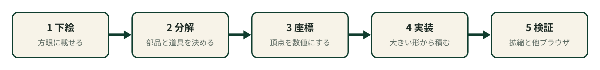
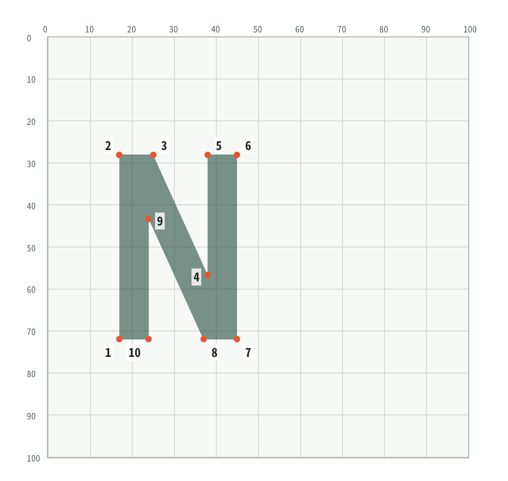

# 2章 描く前に設計する

## この章でできるようになること

- 描きたい絵を方眼に載せ、頂点を数値にする
- 絵を部品に分け、部品ごとに使う道具を決める
- 斜めの線に沿う点の座標を計算する

CSSの絵が崩れる最大の原因は、コードより前の段階にあります。この章の手順を踏めば、実装はほぼ写経になります。

## 問題: 目分量で詰めると終わらない

`top: 37px; left: 52px;` と書き、ずれていたら1pxずつ動かす。この進め方には欠点が3つあります。

- 部品が増えるほど、調整の組み合わせが増える
- 大きさを変えると全部やり直しになる
- 斜めの線が絡むと、目では合わせられない

1章の雪の座標 `26.8%` を、目分量で当てるのは無理です。

## 解決: 5つの工程で進める



*図2-1 制作の流れ。コードを書くのは4番目*

| 工程 | やること | 成果物 |
|---|---|---|
| 1 下絵 | 手描きや図形ソフトで絵を決め、方眼に載せる | 方眼つきの下絵 |
| 2 分解 | 絵を部品に分け、部品ごとに道具を決める | 部品表 |
| 3 座標 | 各部品の頂点・中心・半径を数値にする | 座標表 |
| 4 実装 | 大きい形から順にCSSにする | コード |
| 5 検証 | 拡縮と他ブラウザで崩れないか見る | スクリーンショット |

以下、工程ごとに説明します。

## 工程1 下絵を方眼に載せる

**100×100の方眼**を使います。左上が (0, 0)、右下が (100, 100) です。

この座標系を選ぶ理由は、CSSの `%` とそのまま対応するからです。方眼で (35, 40) の点は、CSSでは `35% 40%` と書けます。換算が要りません。

下絵は紙でも構いません。10マスごとに線を引いた正方形を描き、その中に絵を収めます。図形ソフトを使うなら、100×100のアートボードにグリッドを表示します。

このとき、**線の太さや余白をきりのいい数字にそろえる**と後が楽です。線の太さは7、文字の高さは44、のように決めておきます。

## 工程2 部品に分け、道具を決める

絵を「1色で塗れる、ひとかたまりの形」に分けます。1章のバッジなら、空、太陽、山、雪、縁の5部品です。

次に、部品ごとに道具を決めます。次の表を上から順に見て、最初に当てはまったものを使ってください。

| 部品の形 | 使う道具 | 章 |
|---|---|---|
| 長方形、角丸、円、楕円 | `width` / `height` と `border-radius` | 3章 |
| 輪、同心円、縞、扇形、水玉 | グラデーションの背景 | 3章 |
| 直線だけで囲まれた形 | `clip-path: polygon()` | 4章 |
| 直線と円弧で囲まれた形 | `clip-path: shape()` | 4章 |
| 穴の開いた形、欠けた輪 | `mask` | 4章 |
| 同じ小さな形の繰り返し（ドット絵） | `box-shadow` を並べる | 3章 |
| どれにも当てはまらない | さらに細かく分ける | — |

迷ったら `clip-path: polygon()` を選びます。直線で近似できる形なら、ほぼ何でも描けます。

### 箱の数を見積もる

要素1つにつき、箱は3つ使えます。要素自身、`::before`、`::after` です。背景は何枚でも重ねられるので、グラデーションで描ける部品は箱を消費しません。

バッジの場合、空と太陽は背景、縁は枠線なので要素自身に収まります。山と雪が疑似要素を1つずつ使い、合計3箱。子要素なしで足りました。足りないときは子要素を足します。無理に減らす必要はありません（減らす挑戦は7章で扱います）。

## 工程3 頂点を数値にする



*図2-2 Nの字を方眼に載せ、頂点に番号を振ったところ*

図2-2は、7章で作る紋章の「N」です。頂点は10個あります。

| 番号 | 座標 | 決め方 |
|---|---|---|
| 1 | (17, 72) | 左の縦棒の左下。下絵から読む |
| 2 | (17, 28) | 左の縦棒の左上。下絵から読む |
| 3 | (25, 28) | 斜めの帯の上端。下絵から読む |
| 4 | (38, 56.6) | 斜めの帯と右の縦棒の交点。**計算する** |
| 5 | (38, 28) | 右の縦棒の左上。下絵から読む |
| 6 | (45, 28) | 右の縦棒の右上。下絵から読む |
| 7 | (45, 72) | 右の縦棒の右下。下絵から読む |
| 8 | (37, 72) | 斜めの帯の下端。下絵から読む |
| 9 | (24, 43.4) | 斜めの帯と左の縦棒の交点。**計算する** |
| 10 | (24, 72) | 左の縦棒の右下。下絵から読む |

10個のうち8個は下絵から読むだけです。計算が要るのは、斜めの線と縦の線が交わる2点だけです。

### 斜めの線の上の点を計算する

使うのは中学の一次関数です。

1. 斜めの線の両端を決める。帯の上側の辺は (25, 28) から (45, 72) へ引いた線
2. 傾きを出す。縦の変化 ÷ 横の変化 ＝ (72 − 28) ÷ (45 − 25) ＝ **2.2**
3. 求めたい点の x を入れる。頂点4は x ＝ 38 なので、起点から横に 13 進んだ位置
4. y ＝ 28 ＋ 13 × 2.2 ＝ **56.6**

頂点9も同じです。帯の下側の辺は (17, 28) から (37, 72) で、傾きは同じ2.2。x ＝ 24 は起点から横に7なので、y ＝ 28 ＋ 7 × 2.2 ＝ 43.4 です。

1章の雪の `26.8%` も同じ計算で出しています。山の左の斜面は (0, 100) から (35, 40)。y ＝ 54 になる x を逆算すると 26.8 です。

> **ヒント**
> 計算が面倒なら、表計算ソフトに式を1つ入れておけば済みます。円周上の点が必要なときは、中心 (cx, cy)、半径 r、角度 θ から x ＝ cx ＋ r × sin θ、y ＝ cy − r × cos θ で求めます（真上を0度、時計回り）。

座標表ができたら、CSSはこうなります。

```css
.n {
  clip-path: polygon(
    17% 72%, 17% 28%, 25% 28%, 38% 56.6%, 38% 28%,
    45% 28%, 45% 72%, 37% 72%, 24% 43.4%, 24% 72%);
}
```

表を左から写しただけです。

## 工程4 大きい形から積む

実装の順番は、奥から手前、大から小です。背景の円、次に大きな面、最後に細部。こうすると、途中のどの段階でも「絵として見られる状態」になり、ずれに早く気づけます。

もう1つ、守ると楽になる決まりがあります。**部品を載せる箱は、すべて親と同じ大きさにする**ことです。

```css
.art > * {
  position: absolute;
  inset: 0;
}
```

箱の位置は全部同じにして、形は `clip-path` で切る。こうすると `top` や `left` を考える必要が無くなり、座標表の数字をそのまま使えます。1章の山と雪も、この方法で描いていました。

## 工程5 検証する

最低限、次の3つを確かめます。

- 大きさを 24px、100px、400px に変えて崩れないか
- 下絵と重ねてずれが無いか（下絵を半透明にして背面に置く）
- 方眼を重ねて、頂点が狙った位置にあるか

方眼は次のCSSで重ねられます。

```css
.art.debug::after {
  content: "";
  position: absolute;
  inset: 0;
  background:
    repeating-linear-gradient(0deg,  rgba(255,255,255,.35) 0 1px, transparent 1px 10%),
    repeating-linear-gradient(90deg, rgba(255,255,255,.35) 0 1px, transparent 1px 10%);
}
```

`::after` をすでに部品に使っている場合は、子要素を1つ足して同じ背景を当てます。

## よくある失敗

| 失敗 | 対策 |
|---|---|
| 下絵なしで書き始める | 紙の落書きでいいので、方眼に載せてから始める |
| pxで座標を書く | `%` で書く。拡縮できなくなる |
| 斜めの帯を `rotate` で回して置く | 位置合わせが難しく、継ぎ目に隙間が出る。polygon で描く（6章） |
| 細部から作り始める | 大きい形から。全体の釣り合いを先に確かめる |

## 次にやること

1. 描きたい絵を1つ決め、100×100の方眼に下絵を描く
2. 部品表を作る。部品名、色、使う道具の3列
3. 直線だけの部品を1つ選び、座標表を作って `polygon()` で描く
