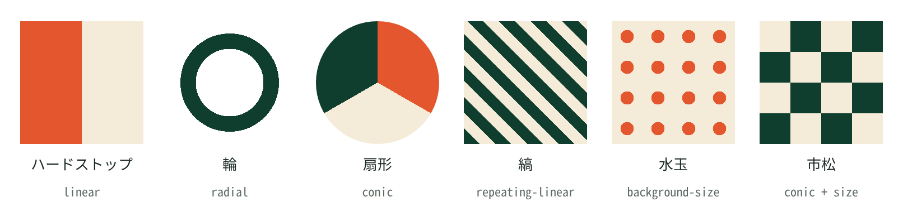
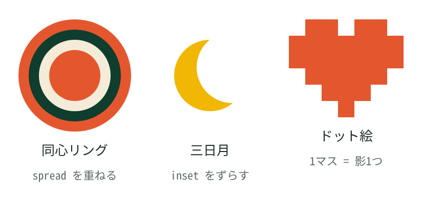

# 3章 道具箱1: 箱・角丸・グラデーション・影

## この章でできるようになること

- 角丸だけで円、楕円、しずく、卵を作る
- グラデーションで輪、扇形、縞、水玉、市松を描く
- 影を重ねて、同心リング、三日月、ドット絵を描く

この章の道具は、どれも**箱を増やさずに描ける**のが強みです。要素1つの背景と影だけで、かなりの形が作れます。

## 3.1 箱と角丸

長方形は `width` と `height`、色は `background`。ここまでは普段のCSSと同じです。絵では `border-radius` の使い方が広がります。

| 書き方 | 結果 |
|---|---|
| `border-radius: 50%` | 正方形なら円、長方形なら楕円 |
| `border-radius: 10px` | 四隅が同じ丸み |
| `border-radius: 0 50% 50% 50%` | 左上だけ尖る。45度回すとしずく |
| `border-radius: 50% 50% 50% 50% / 60% 60% 40% 40%` | 上が細く下が太い。卵 |

4つ目の書き方が要点です。スラッシュの前が各角の**横方向**の半径、後ろが**縦方向**の半径です。左上、右上、右下、左下の順に4つずつ、合計8つの値で、角ごとに楕円の丸みを指定できます。Diana Smith のような有機的な絵は、この8値の角丸を大量に重ねて作られています。

```css
.egg  { border-radius: 50% 50% 50% 50% / 60% 60% 40% 40%; }
.drop { border-radius: 0 50% 50% 50%; transform: rotate(45deg); }
```

## 3.2 グラデーションで描く

グラデーションは「色がなだらかに変わる模様」ですが、絵を描くときは**ぼかさずに使います**。同じ位置で色を切り替えると、境界のはっきりした形になります。これをハードストップと呼びます。



*図3-1 グラデーションだけで描いた形。どれも要素1つ、子要素なし*

### 3種類のグラデーション

| 関数 | 色が変わる向き | 描けるもの |
|---|---|---|
| `linear-gradient` | 直線に沿って | 帯、縞、斜めの塗り分け |
| `radial-gradient` | 中心から外へ | 円、輪、同心円、水玉 |
| `conic-gradient` | 中心のまわりを回って | 扇形、円グラフ、市松、放射 |

図3-1のコードです。

```css
/* ハードストップ: 50%の位置で色を切り替える */
.g1 { background: linear-gradient(90deg, var(--red) 50%, var(--cream) 50%); }

/* 輪: 55%〜80%だけ色を付ける */
.g2 { background: radial-gradient(closest-side,
        transparent 55%, var(--green) 55% 80%, transparent 80%); }

/* 扇形: 120度ずつ3色 */
.g3 { border-radius: 50%;
      background: conic-gradient(var(--red) 0 120deg,
        var(--cream) 120deg 240deg, var(--green) 240deg); }

/* 縞: 20pxごとに繰り返す */
.g4 { background: repeating-linear-gradient(45deg,
        var(--green) 0 10px, var(--cream) 10px 20px); }

/* 水玉: 小さな円を25%角のタイルにして敷き詰める */
.g5 { background:
        radial-gradient(circle, var(--red) 30%, transparent 31%) 0 0 / 25% 25%,
        var(--cream); }

/* 市松: 4分割の扇形を50%角のタイルにする */
.g6 { background: conic-gradient(var(--green) 25%, var(--cream) 0 50%,
        var(--green) 0 75%, var(--cream) 0) 0 0 / 50% 50%; }
```

### 覚えておく書き方

**色の後ろに位置を2つ書ける。** `var(--green) 55% 80%` は「55%から80%まで緑」という意味です。開始と終了を1行で書けます。

**`closest-side` を付ける。** `radial-gradient` の100%は、既定では中心から最も遠い**角**までの距離です。正方形の箱なら、辺までの約1.41倍になります。`closest-side` を付けると100%が辺までの距離になり、「半径の何%」という直感どおりに書けます。

**位置に0を書くと「直前と同じ位置」になる。** 市松の `var(--cream) 0 50%` の0は、前の色の終わり（25%）に繰り上がります。数字を繰り返さずに済む省略記法です。

**背景は重ねられ、大きさと位置を個別に決められる。** `背景 位置 / 大きさ` の順に書きます。水玉の `0 0 / 25% 25%` は「左上から、25%角のタイルで」という意味です。繰り返したくないときは `no-repeat` を足します。

> **注意**
> グラデーションの背景は、透明を指定しない限り箱全体を塗ります。複数の形を重ねるときは、形の外側を必ず `transparent` にしてください。

### どれを使うか迷ったら

- 円や輪 → `radial-gradient`
- 角度で区切りたい → `conic-gradient`
- 同じ模様の繰り返し → `repeating-` を頭に付けるか、`background-size` でタイルにする

## 3.3 影で描く

`box-shadow` は、箱と同じ形の複製を、ずらして描く機能です。絵では「影」ではなく**複製の道具**として使います。



*図3-2 box-shadow で描いた形*

書式は `横のずれ 縦のずれ ぼかし 広がり 色` です。絵ではぼかしを0にします。

### 同心リング: 広がりを重ねる

```css
.rings {
  width: 50px; height: 50px;
  border-radius: 50%;
  background: var(--red);
  box-shadow:
    0 0 0 10px var(--cream),
    0 0 0 20px var(--green),
    0 0 0 30px var(--red);
}
```

4番目の値（広がり）を大きくすると、箱より大きい複製になります。カンマで並べると重なり、**先に書いたものが手前**です。小さい順に書けば同心円になります。

影は箱の外にはみ出して描かれ、レイアウト上の大きさには含まれません。周囲に余白を取ってください。

### 三日月: 内側の影をずらす

```css
.moon {
  width: 70px; height: 70px;
  border-radius: 50%;
  box-shadow: inset 22px -8px 0 0 #f2b705;
}
```

`inset` を付けると影が箱の内側に描かれます。ずらした分だけ縁に色が残り、三日月になります。背景は指定しません。

### ドット絵: 1マスを影1つで描く

1マス分の小さな箱を1つ用意し、影を必要な数だけ並べます。

```css
.heart {
  width: 1em; height: 1em;       /* 1マスの大きさ */
  font-size: 16px;               /* ここを変えると全体が拡縮する */
  box-shadow:
    1em 0 0 #e4572e, 2em 0 0 #e4572e, 4em 0 0 #e4572e, 5em 0 0 #e4572e,
    0 1em 0 #e4572e, 1em 1em 0 #e4572e, 2em 1em 0 #e4572e, /* ... */
    3em 5em 0 #e4572e;
}
```

ずれを `em` で書くのがこつです。参考にした日本語記事ではpxで書かれていましたが、pxだと大きさを変えるたびに全部書き直しになります。`em` なら `font-size` を変えるだけです。

手で書く量ではないので、マス目のデータからスクリプトで生成します。

```js
const rows = ["0110110", "1111111", "1111111", "0111110", "0011100", "0001000"];
const shadows = rows.flatMap((row, y) =>
  [...row].map((c, x) => c === "1" ? `${x}em ${y}em 0 #e4572e` : null)
).filter(Boolean).join(", ");
```

> **注意**
> 影はマスの数だけ描画されます。数百マスなら問題になりませんが、数千マスを動かすと重くなります。大きなドット絵は9章の「使い分け」を見て、canvasや画像を検討してください。

## 3.4 枠線で描く三角形

古くからある手法です。幅と高さを0にした箱に太い枠線を付けると、4辺の枠線がそれぞれ三角形になります。1辺だけ色を付け、隣の2辺を透明にすると三角形が残ります。

```css
.triangle {
  width: 0; height: 0;
  border-left: 45px solid transparent;
  border-right: 45px solid transparent;
  border-bottom: 80px solid var(--green);
}
```

今は `clip-path: polygon()` のほうが素直に書けます。枠線の三角形には影やグラデーションを付けられない、という制約もあります。古いコードを読むために知っておけば十分です。

## 道具の選び方まとめ

| 描きたいもの | 第一候補 | 理由 |
|---|---|---|
| 円、楕円、角丸 | `border-radius` | 縁が最もきれい |
| 輪を1〜2本 | `radial-gradient` | 箱を増やさない |
| 輪を外側に足す | `box-shadow` の広がり | 書くのが楽 |
| 縞、水玉、市松 | グラデーション＋`background-size` | 繰り返しに強い |
| 扇形、放射状 | `conic-gradient` | 角度で指定できる |
| 同じ形の複製 | `box-shadow` | 何個でも並べられる |

## 次にやること

1. 図3-1の6つを自分で書き、色と数字を変えて変化を見る
2. `radial-gradient` 1つで、3重の同心円（的）を描く
3. 8×8マスの好きなドット絵を、スクリプトで生成して表示する

## 出典

- [Single Div Drawings with CSS（Lynn Fisher, Mozilla Hacks）](https://hacks.mozilla.org/2014/09/single-div-drawings-with-css/)
- [Diana Smith's Top 5 CSS Properties She Uses to Produce CSS Art（CSS-Tricks）](https://css-tricks.com/diana-smiths-top-5-css-properties-she-uses-to-produce-css-art/)
- [CSSでドット絵（ponhiro）](https://ponhiro.com/css-dot-illust/)
