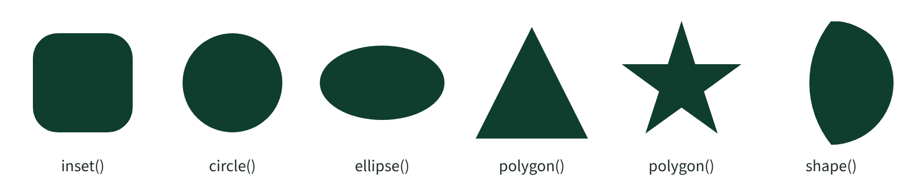
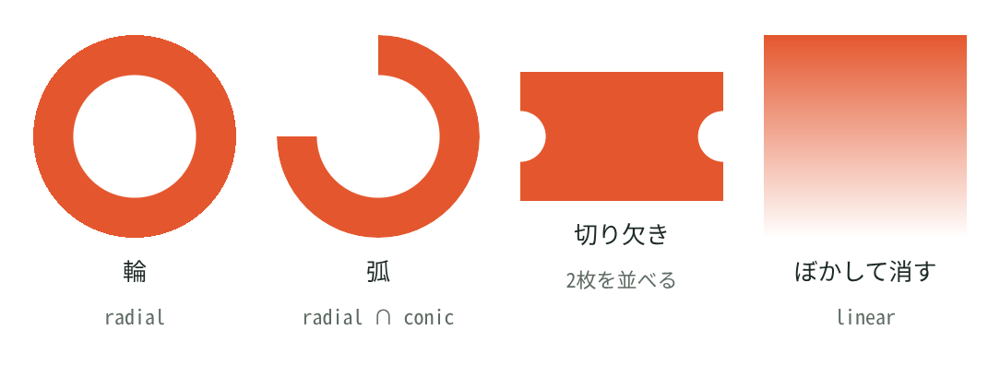

# 4章 道具箱2: 切り抜きとマスク

## この章でできるようになること

- `clip-path` の6つの関数を使い分ける
- `mask` で輪、弧、切り欠きを作る
- 「切り抜き」と「マスク」のどちらを使うか即決する

3章の道具は「色を置く」ものでした。この章の道具は「要らない部分を消す」ものです。箱をいったん塗りつぶし、残したい形だけを残します。

## 4.1 clip-path: 輪郭で切り抜く

`clip-path` は、指定した輪郭の内側だけを表示します。外側は描画されず、クリックにも反応しません。図4-1に、6つの関数で切り抜いた結果を並べました。



*図4-1 同じ緑の正方形を、関数を変えて切り抜いた結果*

| 関数 | 描ける輪郭 | 使いどころ |
|---|---|---|
| `inset()` | 長方形。`round` で角丸 | 縁を一定幅だけ削る |
| `circle()` | 円 | 中心と半径で指定したい円 |
| `ellipse()` | 楕円 | 同上 |
| `polygon()` | 直線で結んだ多角形 | **最もよく使う** |
| `shape()` | 直線と曲線を混ぜた輪郭 | 円弧を含む形 |
| `path()` | SVGのパス文字列 | 拡縮しない固定サイズの形 |

```css
.c1 { clip-path: inset(10% round 20%); }
.c2 { clip-path: circle(40%); }
.c3 { clip-path: ellipse(50% 30%); }
.c4 { clip-path: polygon(50% 5%, 95% 95%, 5% 95%); }
.c5 { clip-path: polygon(50% 0%, 61% 35%, 98% 35%, 68% 57%, 79% 91%,
                         50% 70%, 21% 91%, 32% 57%, 2% 35%, 39% 35%); }
.c6 { clip-path: shape(from 50% 0%,
        arc to 50% 100% of 50% cw,
        arc to 50% 0% of 80% cw, close); }
```

### polygon() の書き方

頂点を `x y` の組で並べ、カンマで区切ります。最後の点と最初の点は自動で結ばれます。

- 時計回りでも反時計回りでも結果は同じ
- 単位は `%` を使う。箱の大きさが変わっても形が保たれる
- `calc()` も使える。`calc(100% - 10px)` で「右端から10px内側」

2章で作った座標表は、そのまま `polygon()` に写せます。

### shape() の書き方

`shape()` は、`polygon()` に曲線を足したものです。ペンを動かす命令を順に書きます。

| 命令 | 意味 |
|---|---|
| `from X Y` | 開始点 |
| `line to X Y` | 直線を引く |
| `arc to X Y of R` | 半径Rの円弧を引く |
| `curve to X Y with CX CY` | 制御点つきの曲線を引く |
| `close` | 開始点まで戻って閉じる |

円弧には回る向きと大きさの指定が付きます。`cw` は時計回り、`ccw` は反時計回り。同じ2点を結ぶ円弧は大回りと小回りの2通りあるので、大回りにしたいときは `large` を付けます。

`path()` との違いは単位です。`path()` はpx固定で、箱を拡縮しても形が変わりません。`shape()` は座標ごとに `%` や `calc()` を使えます。絵を描くなら `shape()` を選んでください。

> **注意**
> `shape()` は新しい機能です。Chrome 135、Safari 18.4、Firefox 148 から使えます。古いブラウザでは切り抜きが効かず、箱がそのまま表示されます。対応状況の確かめ方と代替手段は6章で扱います。

### clip-path の制約

- 切り抜いた外側には何も描けない。影（`box-shadow`）も一緒に消える
- 穴の開いた形は苦手。輪郭を一筆書きで描く必要がある
- 1つの箱に1つの輪郭しか指定できない

2つ目と3つ目の制約を超えたいときに、`mask` を使います。

## 4.2 mask: 濃淡で消す

`mask` は、別の画像の**不透明な部分だけ**を残す機能です。画像にはグラデーションを使えます。つまり、3章で覚えたグラデーションの描き方が、そのまま「消し方」になります。図4-2が、グラデーションをマスクに使った例です。



*図4-2 赤い正方形にマスクをかけた結果*

考え方は単純です。マスクの黒（不透明）の部分が残り、透明の部分が消えます。色は何でも構いません。慣習として残す部分を `#000`、消す部分を `#0000`（透明）と書きます。

### 輪: 中心を抜く

```css
.ring {
  background: var(--red);
  mask: radial-gradient(closest-side, #0000 60%, #000 61% 100%, #0000 0);
}
```

中心から60%までを消し、61%〜100%を残し、その外を消します。3章の輪は「輪に色を塗る」方法でした。こちらは「塗った箱を輪の形に抜く」方法です。背景に模様やグラデーションを使いたいときは、マスクのほうが向いています。

### 弧: 2枚のマスクの重なりだけ残す

```css
.arc {
  border-radius: 50%;
  background: var(--red);
  mask:
    radial-gradient(closest-side, #0000 60%, #000 61%),
    conic-gradient(#000 0 270deg, #0000 0);
  mask-composite: intersect;
}
```

マスクを2枚重ね、`mask-composite: intersect` で「両方が不透明な部分だけ」を残します。1枚目が輪、2枚目が270度の扇形なので、重なりは4分の3周の弧になります。

`mask-composite` の値は4つあります。

| 値 | 残る部分 |
|---|---|
| `add`（既定） | どちらかが不透明な部分 |
| `subtract` | 1枚目から2枚目を引いた部分 |
| `intersect` | 両方が不透明な部分 |
| `exclude` | 片方だけが不透明な部分 |

### 切り欠き: 左右に半円の欠けを作る

```css
.ticket {
  background: var(--red);
  mask:
    radial-gradient(circle 14px at 0 50%, #0000 97%, #000) 0 0 / 51% 100% no-repeat,
    radial-gradient(circle 14px at 100% 50%, #0000 97%, #000) 100% 0 / 51% 100% no-repeat;
}
```

左半分と右半分に1枚ずつマスクを置き、それぞれの外側の辺に半円の穴を開けています。幅を `51%` にして1%重ねているのは、中央に隙間が出るのを防ぐためです（隙間の話は6章）。

### ぼかして消す

```css
.fade { mask: linear-gradient(#000, #0000); }
```

グラデーションをぼかしたまま使えば、だんだん消える表現になります。`clip-path` にはできないことです。

> **注意**
> 古いブラウザ向けには `-webkit-mask` の併記が必要です。`mask-image` が主要ブラウザで接頭辞なしに使えるようになったのは2023年12月です。合成の指定は接頭辞つきだと値の名前が違い、`intersect` に当たるのは `-webkit-mask-composite: source-in` です。

## 4.3 どちらを使うか

| 条件 | 使うもの |
|---|---|
| 輪郭が一筆書きで描ける | `clip-path` |
| 穴が開いている | `mask` |
| 縁をぼかしたい、だんだん消したい | `mask` |
| 形を動かしたい | `clip-path`（頂点数が同じ `polygon()` 同士は補間できる） |
| 縁を最もきれいにしたい | `clip-path` |
| 切り抜いた形に影を付けたい | どちらも直接は不可。親要素に `filter: drop-shadow()` |

迷ったら `clip-path` から試します。書くのが楽で、縁の品質も安定しています。

## 4.4 変形と重なり

切り抜いた部品は、`transform` で回したり傾けたりできます。

| 関数 | 効果 | 絵での使い道 |
|---|---|---|
| `rotate(45deg)` | 回す | しずく、ひし形 |
| `skewX(-20deg)` | 斜めにゆがめる | 平行四辺形 |
| `scale(-1, 1)` | 左右反転 | 左右対称の部品を使い回す |
| `translate(10%, 0)` | ずらす | 微調整 |

回転の中心は `transform-origin` で変えられます。既定は箱の中央です。

重なりの順番は、後に書いた要素が手前です。`::before` は子要素より奥、`::after` は子要素より手前に描かれます。変えたいときは `z-index` を使いますが、`transform`、`opacity`、`filter`、`mask`、`clip-path` などを指定した要素は、中の重なり順が外と切り離されます。部品の中の部品が思った順に重ならないときは、まずこれを疑ってください。

## 次にやること

1. 図4-1の星の頂点を動かし、太い星と細い星を作る
2. `polygon()` で矢印を描く（頂点は7つ）
3. 図4-2の弧の角度を変え、半円と4分の1円の弧を作る
4. `shape()` で、上が丸く下が平らなかまぼこ形を描く

## 出典

- [Use shape() for responsive clipping（Chrome for Developers）](https://developer.chrome.com/blog/css-shape)
- [clip-path（MDN）](https://developer.mozilla.org/en-US/docs/Web/CSS/clip-path)
- [mask-image（MDN）](https://developer.mozilla.org/en-US/docs/Web/CSS/mask-image)
- [The Modern Guide For Making CSS Shapes（Temani Afif, Smashing Magazine）](https://www.smashingmagazine.com/2024/05/modern-guide-making-css-shapes/)
- [Arc shape（CSS Tip）](https://css-tip.com/arc-shape/)
