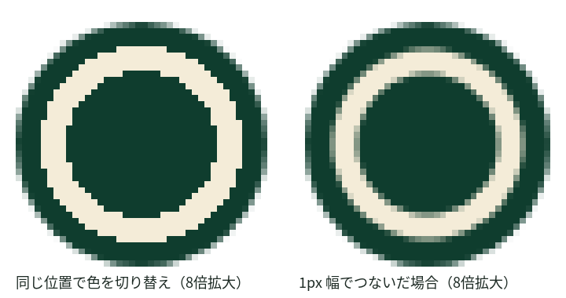
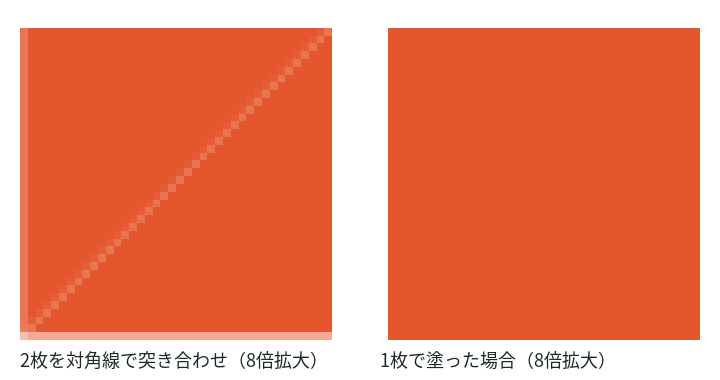

# 6章 仕上げの質を上げる

## この章でできるようになること

- 絵を任意の大きさに拡縮できるように作る
- 円の縁のギザギザを消す
- 部品の継ぎ目に出る細い隙間を消す
- 新しい機能を、古いブラウザで崩さずに使う

ここまでの章で形は描けるようになりました。この章は、描いた絵を「小さくしても大きくしても、どの画面でもきれい」にするための章です。

## 6.1 拡縮できるように作る

### 問題

160pxで作った絵を48pxのアイコンにしたら崩れた。

### 解決

寸法の基準を1か所にまとめ、他のすべてをそこからの比率で書きます。

```css
.art {
  --size: 160px;
  width: var(--size);
  aspect-ratio: 1;
  position: relative;
}
.art > * { position: absolute; inset: 0; }   /* 形は % の clip-path で切る */
```

これで `--size` を変えるだけで全体が拡縮します。

### 解説

崩れる原因は、px で書いた値が残っていることです。次の表で置き換えてください。

| px で書きがちな値 | 置き換え |
|---|---|
| 部品の位置と大きさ | `%`、または `inset: 0` ＋ `clip-path` |
| 枠線の太さ | `calc(var(--size) * 0.05)` |
| 影のずれと広がり | `em`（親の `font-size` を基準にする） |
| グラデーションの位置 | `%` |
| 角丸 | `%` |

枠線と影は `%` を受け付けません。枠線は変数からの計算、影は `em` で書きます。`em` を使う場合は、絵のルートで `font-size: calc(var(--size) / 10)` のように決めておくと、`1em` が絵の10分の1になり計算しやすくなります。

親要素の幅に合わせて拡縮したい場合は、コンテナ単位が使えます。

```css
.art { container-type: inline-size; width: 100%; aspect-ratio: 1; }
.art .part { border-width: 5cqi; }    /* 親の幅の5% */
```

`cqi` は「コンテナの幅の1%」です。ただし `container-type` を付けた要素は、中身から自分の大きさを決められなくなります。`aspect-ratio` か明示的な幅を必ず併用してください。

## 6.2 円の縁のギザギザを消す

### 問題

グラデーションで描いた円や輪の縁が、階段状にギザギザする。

### 解決

色を切り替える位置に、1ピクセル分の幅を持たせます。

```css
.rings {
  --aa: 1px;
  background: radial-gradient(closest-side,
    var(--green) calc(60% - var(--aa)), var(--cream) 60%,
    var(--cream) calc(80% - var(--aa)), var(--green) 80%);
}
@media (min-resolution: 2dppx) { .rings { --aa: .5px; } }
@media (min-resolution: 3dppx) { .rings { --aa: .34px; } }
```

図6-1は、対策の前後を8倍に拡大して並べたものです。



*図6-1 左は同じ位置で色を切り替えた輪、右は1px幅でつないだ輪*

### 解説

`border-radius` で作った円は、ブラウザが縁をなめらかに描きます。グラデーションのハードストップにはこの処理が効かず、ピクセル単位で色が切り替わるため階段状になります。

対策は、切り替えの位置をごくわずかにぼかすことです。ぼかす幅の決め方には段階があります。

| 方法 | 書き方 | 評価 |
|---|---|---|
| %でずらす | `59%` と `60%` | 大きい絵でぼやけ、小さい絵でまだギザつく |
| 1pxずらす | `calc(60% - 1px)` | 普通の画面ではきれい。高密度の画面ではややぼやける |
| 画面密度で割る | 上記の `--aa` | どの画面でも1物理ピクセル分になる。**推奨** |

`--aa` を使う方法は、Ana Tudor が記事で詳しく検証しています。画面密度2倍の画面では0.5px、3倍なら約0.33pxが、ちょうど1物理ピクセルです。

`mask` に使うグラデーションにも同じ対策が要ります。`conic-gradient` の角度の境界も同様で、こちらは `232deg` と `232.4deg` のように、角度をわずかにずらします。

> **ヒント**
> 縁の品質を最優先するなら、グラデーションをやめて `border-radius` や `clip-path` で描けないか考えてください。この2つは、ブラウザが縁をなめらかにしてくれます。

## 6.3 継ぎ目の隙間を消す

### 問題

2つの部品をぴったり並べたのに、境目に髪の毛ほどの細い線が見える。

### 解決

**部品を分けず、1つの形にまとめます。** まとめられないときは、少し重ねます。

図6-2の左は、2つの三角形を対角線で突き合わせた正方形です。境目に、背景の白が透けた線が出ています。



*図6-2 左は2枚の三角形を突き合わせたもの、右は1枚で塗ったもの*

### 解説

斜めの辺は、ピクセルの格子にぴったり乗りません。ブラウザは辺の上のピクセルを「半分だけ塗る」ことで、なめらかに見せます。2つの部品がそれぞれ半分ずつ塗ると、重なった部分は100%にならず、背景がうっすら透けます。これが細い線の正体です。

対策を、効果の確実な順に並べます。

| 対策 | やり方 |
|---|---|
| 1つにまとめる | 2枚の `polygon()` を、1枚の `polygon()` に書き直す |
| 重ねる | 片方の頂点を、相手側に1%ほど食い込ませる |
| 下地を敷く | 継ぎ目の下に、同じ色の箱を置く |

2章で「N」を3本の棒に分けず、10頂点の1枚にしたのは、この隙間を避けるためです。4章の切り欠きで、マスクの幅を50%ではなく51%にしたのも同じ理由です。

色の違う部品が隣り合う場合はまとめられないので、奥の部品を大きめに作って、手前の部品の下に潜り込ませます。

## 6.4 新しい機能を安全に使う

### 問題

`shape()` や `corner-shape` を使いたいが、古いブラウザで崩れるのが心配。

### 解決

先に無難な書き方をして、`@supports` の中で新しい書き方に差し替えます。

```css
/* まず、どこでも動く近似 */
.five { clip-path: polygon(/* 円弧を細かい直線で近似した座標 */); }

/* shape() が使えるブラウザだけ、正確な円弧にする */
@supports (clip-path: shape(from 0 0, line to 1px 1px, close)) {
  .five { clip-path: shape(from 63% 28%, /* ... */ close); }
}
```

### 解説

ブラウザは、理解できない宣言を無視します。`@supports` を使わず2行並べても、後の行が無視されるだけなので同じ結果になります。`@supports` は、複数の宣言をまとめて切り替えたいときに使います。

主な新機能の対応状況は付録Bにまとめました。本書執筆時点（2026年11月）の目安は次のとおりです。

| 機能 | 状況 | 使い方の方針 |
|---|---|---|
| `polygon()`、`mask`、グラデーション | 全主要ブラウザ | そのまま使う |
| `sin()` / `cos()` | 全主要ブラウザ | そのまま使う |
| `@property` | 全主要ブラウザ（2024年7月〜） | そのまま使う |
| `shape()` | 全主要ブラウザ（2026年2月〜） | 近似の `polygon()` を先に書く |
| `corner-shape` | Chrome / Edge のみ | 装飾にとどめる |

## 6.5 複数のブラウザで確かめる

### 問題

手元のChromeではきれいだが、他のブラウザでどう見えるか分からない。

### 解決

スクリーンショットを自動で撮り、並べて見ます。Playwright を使うと、Chromium、Firefox、WebKit（Safariのエンジン）の3つで同じページを描画できます。

```python
from playwright.sync_api import sync_playwright

with sync_playwright() as p:
    for name in ("chromium", "firefox", "webkit"):
        browser = getattr(p, name).launch()
        for scale in (1, 2, 3):                      # 画面密度
            page = browser.new_page(device_scale_factor=scale)
            page.goto("file:///path/to/art.html")
            page.locator(".art").screenshot(path=f"{name}-{scale}x.png")
        browser.close()
```

### 解説

本書の図は、この方法でChromeから撮っています（FirefoxとWebKitでの撮影は行っていません）。

ブラウザ間で差が出やすい箇所は次のとおりです。

- **グラデーションの境界。** ぼかしの出方が微妙に違う
- **小数ピクセルの丸め。** 1px未満のずれが、小さい絵で目立つ
- **透明へのグラデーション。** ぼかしたグラデーションで `transparent` へつなぐと、途中が黒ずむ現象がSafariで報告されている（古い記事で、現行版で直っているかは未確認）。同じ色のアルファ0（赤なら `rgb(228 87 46 / 0)`）を使えば避けられる
- **新しい機能の有無。** 6.4を参照

Diana Smith の作品は、Chrome向けに作られており、他のブラウザや古いブラウザでは別の絵のように崩れます。本人はそれを承知で作っています。作品として作るなら割り切りもありですが、サイトの部品として使うなら、3つのエンジンで確かめてください。

## 検証のチェックリスト

- [ ] 24px、100px、400pxで形が保たれる
- [ ] 画面密度1倍、2倍、3倍で縁がきれい
- [ ] ブラウザのズーム50%と200%で隙間が出ない
- [ ] Chromium、Firefox、WebKitで大きな差が無い
- [ ] 新しい機能を使った箇所に、代替の書き方がある

## 次にやること

1. 1章のバッジの枠線 `8px` を、`--size` からの計算に書き換える
2. 自分の絵の中で、グラデーションで描いた円を探し、`--aa` の対策を入れる
3. ブラウザのズームを50%にして、継ぎ目に線が出ていないか見る

## 出典

- [Obsessing Over Smooth radial-gradient Disc Edges（Ana Tudor, Frontend Masters）](https://frontendmasters.com/blog/obsessing-over-smooth-radial-gradient-disc-edges/)
- [container-type（MDN）](https://developer.mozilla.org/en-US/docs/Web/CSS/container-type)
- [Visual comparisons（Playwright）](https://playwright.dev/docs/test-snapshots)
- [purecss-francine（Diana Smith, GitHub）](https://github.com/cyanharlow/purecss-francine)
