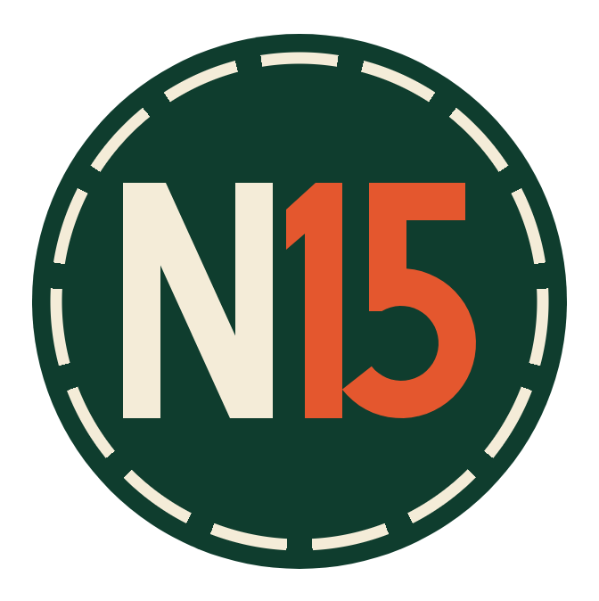
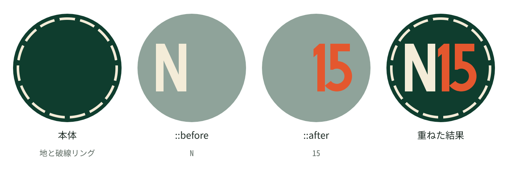

# 7章 総合演習: 紋章を作り切る

## この章でできるようになること

- 下絵からコードまで、1つの絵を通しで仕上げる
- 同じ絵を、3通りの制約（子要素あり、`shape()`、single-div）で描き分ける
- 円弧の端点を計算して、直線と曲線を1本の輪郭にまとめる

題材は、筆者のサイト用に作った紋章「N15」です。図7-1が完成形です。



*図7-1 この章で作る紋章*

2章の5工程（下絵、分解、座標、実装、検証）に沿って進めます。

## 7.1 下絵と分解

100×100の方眼に下絵を載せ、部品に分けます。

| 部品 | 色 | 形 | 使う道具 |
|---|---|---|---|
| 地の円 | 緑 | 半径50の円 | `border-radius` |
| 破線リング | クリーム | 半径44.5〜46.5、15分割 | `repeating-conic-gradient` を輪に抜く |
| N | クリーム | 直線10頂点 | `polygon()` |
| 1 | 赤 | 直線7頂点 | `polygon()` |
| 5の上半分 | 赤 | 直線6頂点 | `polygon()` |
| 5の腹 | 赤 | 欠けた輪 | `conic-gradient` ＋ `mask` |

寸法の決まりごとは次のとおりです。先に決めておくと、座標がきりのいい数字になります。

- 文字の高さ: y ＝ 28 から 72 まで（44）
- 線の太さ: 7
- 5の腹: 中心 (69, 58)、外側の半径14、内側の半径7

## 7.2 基本版: 子要素4つで描く

まず、いちばん素直な構成で作ります。地と破線リングは親要素の背景、文字は子要素です。

```html
<div class="n15">
  <i class="n"></i><i class="one"></i><i class="five-top"></i><i class="five-bowl"></i>
</div>
```

```css
.n15 {
  --size: 260px;
  --green: #0f3d2e; --cream: #f4ecd8; --red: #e4572e;
  --aa: 1px;
  position: relative;
  width: var(--size); aspect-ratio: 1;
  border-radius: 50%;
  background:
    /* 手前: 輪の部分（89%〜93%）だけ透明にして、下の破線を見せる */
    radial-gradient(closest-side,
      var(--green) calc(89% - var(--aa)), transparent 89%,
      transparent 93%, var(--green) calc(93% + var(--aa))),
    /* 奥: 24度周期の放射状の縞。15本 */
    repeating-conic-gradient(from -9deg, var(--cream) 0 18deg, var(--green) 18deg 24deg),
    var(--green);
}
@media (min-resolution: 2dppx) { .n15 { --aa: .5px; } }
@media (min-resolution: 3dppx) { .n15 { --aa: .34px; } }

.n15 > i { position: absolute; inset: 0; display: block; }

.n15 .n {
  background: var(--cream);
  clip-path: polygon(
    17% 72%, 17% 28%, 25% 28%, 38% 56.6%, 38% 28%,
    45% 28%, 45% 72%, 37% 72%, 24% 43.4%, 24% 72%);
}
.n15 .one {
  background: var(--red);
  clip-path: polygon(51% 72%, 51% 37.5%, 47.5% 40.5%, 47.5% 33%,
                     53% 28%, 58% 28%, 58% 72%);
}
.n15 .five-top {
  background: var(--red);
  clip-path: polygon(63% 28%, 81% 28%, 81% 35%, 70% 35%, 70% 52%, 63% 52%);
}
.n15 .five-bowl {
  inset: auto; left: 55%; top: 44%; width: 28%; height: 28%;
  border-radius: 50%;
  background: conic-gradient(var(--red) 0 232deg,
    transparent 232.4deg 341.6deg, var(--red) 342deg);
  mask: radial-gradient(closest-side, transparent calc(50% - var(--aa)), #000 50%);
}
```

### 要点

**破線リングは2枚の背景で作る。** 奥に放射状の縞を敷き、手前に「輪の部分だけ透明な緑」を重ねます。5章のレシピ5.2は `mask` で抜きましたが、ここでは親要素に子要素が入るので `mask` を使えません（子要素まで消えてしまいます）。背景の重ねで同じ結果を出しています。

**Nは1枚のpolygon。** 2章で作った座標表をそのまま写しています。

**5の腹だけ、箱の位置と大きさを変える。** 中心 (69, 58)、半径14の円なので、左端は 69 − 14 ＝ 55、上端は 58 − 14 ＝ 44、幅と高さは28です。他の部品は `inset: 0` のままです。

### 実際にあった失敗

最初の版では、5の腹を325度から始めていました。描画すると、縦棒との接合部に小さな出っ張りが出ました。輪の外周が、縦棒の左端（x ＝ 63）より外にはみ出していたためです。開始を342度に変え、縦棒を y ＝ 52 まで伸ばして解決しました。

教訓は、**曲線と直線の接合部は、計算だけで済ませず拡大して目で見る**ことです。

## 7.3 挑戦1: shape() で「5」を1つにまとめる

基本版の「5」は、上半分（polygon）と腹（conic ＋ mask）の2部品でした。`shape()` を使うと、直線と円弧を1本の輪郭にまとめられます。

### 輪郭をたどる

5の輪郭を、左上から時計回りにたどります。

1. 左上 (63, 28) から右へ。上の横棒の右端 (81, 28)
2. 下へ7。(81, 35)
3. 左へ。縦棒の右辺 (70, 35)
4. 下へ。縦棒の右辺が、腹の外周とぶつかる点
5. 外周に沿って時計回りに、腹の終わりまで
6. 内周へ直線で渡る
7. 内周に沿って反時計回りに戻り、縦棒の下端 (y ＝ 52) まで
8. 左へ (63, 52)、上へ戻って閉じる

4、5、6、7の点は計算が要ります。

### 端点を計算する

**4の点: 縦線 x ＝ 70 と外周の交点。** 中心 (69, 58) から横に1ずれた位置なので、三平方の定理で縦のずれを出します。√(14² − 1²) ≒ 13.96。y ＝ 58 − 13.96 ＝ **44.04**

**5の終点: 外周の232度の位置。** 2章の式を使います。

- x ＝ 69 ＋ 14 × sin 232° ＝ **57.97**
- y ＝ 58 − 14 × cos 232° ＝ **66.62**

**6の点: 内周の232度の位置。** 半径を7にして同じ式。(63.48, 62.31)

**7の終点: 内周が y ＝ 52 と交わる点。** 中心から縦に6ずれた位置。√(7² − 6²) ≒ 3.61。x ＝ 69 − 3.61 ＝ **65.39**

### コード

```css
.n15 .five {
  background: var(--red);
  clip-path: shape(from 63% 28%,
    line to 81% 28%, line to 81% 35%, line to 70% 35%,
    line to 70% 44.04%,
    arc to 57.97% 66.62% of 14% cw large,   /* 外周 */
    line to 63.48% 62.31%,
    arc to 65.39% 52% of 7% ccw large,      /* 内周を逆回り */
    line to 63% 52%, close);
}
```

子要素は `<i class="n">`、`<i class="one">`、`<i class="five">` の3つに減ります。`mask` も `conic-gradient` も要らなくなり、縁の品質も `clip-path` に統一されます。

どちらの円弧も半周より長いので `large` を付けています。付け忘れると、同じ2点を結ぶ短いほうの弧が引かれ、形が壊れます。

## 7.4 挑戦2: single-div で描く

子要素をゼロにします。使える箱は、要素自身、`::before`、`::after` の3つです。図7-2が割り当てです。



*図7-2 本体、::before、::after に割り当てた部品*

| 箱 | 部品 |
|---|---|
| 本体 | 地の円と破線リング（背景） |
| `::before` | N |
| `::after` | 1と5 |

問題は `::after` です。1と5は離れた2つの形で、しかも5には円弧があります。5章のレシピ5.11（橋でつなぐ）と、円弧の多角形近似を組み合わせます。

### 円弧を多角形で近似する

円弧を約6度刻みの点で近似します。座標は手で書かず、スクリプトで生成します。

```js
const cx = 69, cy = 58, R = 14, r = 7;
const pt = (rad, deg) => {
  const a = deg * Math.PI / 180;
  return [cx + rad * Math.sin(a), cy - rad * Math.cos(a)];
};
const a0 = Math.asin(1 / R) * 180 / Math.PI;     // 外周が x=70 と交わる角度

const outer = [...Array(39)].map((_, i) => pt(R, a0 + (232 - a0) * i / 38));
const inner = [...Array(36)].map((_, i) => pt(r, 232 - 263 * i / 36));  // 232度→-31度

const pts = [
  [51, 72], [51, 37.5], [47.5, 40.5], [47.5, 33], [53, 28], [58, 28],  // 1
  [63, 28], [81, 28], [81, 35], [70, 35],                               // 橋を渡って5へ
  ...outer, ...inner,
  [65.39, 52], [63, 52], [63, 28],                                      // 5を閉じる
  [58, 28], [58, 72],                                                   // 橋を戻って1を閉じる
];
console.log(pts.map(([x, y]) => `${+x.toFixed(2)}% ${+y.toFixed(2)}%`).join(", "));
```

`[58, 28]` から `[63, 28]` へ渡り、最後に `[63, 28]` から `[58, 28]` へ戻っています。これが橋です。

### コード

```css
.n15.single::before,
.n15.single::after { content: ""; position: absolute; inset: 0; }

.n15.single::before {
  background: var(--cream);
  clip-path: polygon(
    17% 72%, 17% 28%, 25% 28%, 38% 56.6%, 38% 28%,
    45% 28%, 45% 72%, 37% 72%, 24% 43.4%, 24% 72%);
}
.n15.single::after {
  background: var(--red);
  clip-path: polygon(/* スクリプトの出力を貼る。90頂点 */);
}
```

HTMLは `<div class="n15 single"></div>` だけです。

## 7.5 検証

3つの版を並べて描画し、次を確かめました。

| 確認項目 | 結果 |
|---|---|
| 3つの版が同じ見た目になる | 一致 |
| 24px〜360pxで崩れない | 崩れなし |
| 橋の線が見えない | 360pxに拡大しても見えない |
| 多角形近似の角が見えない | 360pxに拡大しても見えない |
| 画面密度1倍、2倍、3倍 | エラーなし（目視は1倍と2倍） |

確認したのはChrome 153のみです。

## 7.6 どの版を使うか

| 版 | 子要素 | 対応ブラウザ | 向く用途 |
|---|---|---|---|
| 基本版 | 4 | 広い | 学習。部品ごとに色や動きを変えたいとき |
| shape() 版 | 3 | 2026年2月以降の主要ブラウザ | コードを短く、正確にしたいとき |
| single-div 版 | 0 | 広い | HTMLを汚したくないとき。ロゴやファビコンの元絵 |

実際にサイトへ置くなら、single-div 版を勧めます。HTMLが `div` 1つで済み、`polygon()` だけなので古いブラウザでも動きます。

single-div は「縛りを楽しむ」流儀として知られていますが、実用上の利点もあります。HTMLに意味のない空要素が増えない、という点です。この論点は9章と11章で触れます。

## この章の教訓

- 寸法の決まりごと（太さ、高さ、中心）を先に決めると、座標がきれいになる
- 曲線と直線の接合部は、拡大して目で確かめる
- 円弧の端点は、三平方の定理と sin / cos で出せる
- 箱が足りなければ、橋でつなぐ。曲線は多角形で近似できる
- 同じ絵でも、制約を変えると使う道具が変わる

## 次にやること

1. 基本版を写して動かし、`--size` を変えて拡縮を確かめる
2. 破線リングの本数を15から12に変える（周期を30度にする）
3. 自分のイニシャルと好きな数字で、同じ構成の紋章を設計する。下絵、部品表、座標表の順に作る
